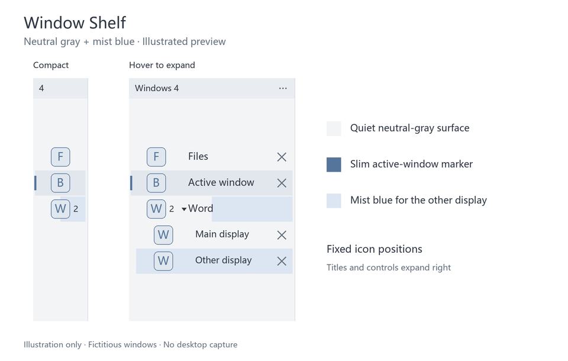

# Window Shelf

[English](README.md) | [简体中文](README.zh-CN.md)

A small Windows window switcher that overlays the application area of a **left-side vertical taskbar**, while keeping the native system tray visible.

**Recommended setup: Windows 11 x64 with a narrow vertical taskbar on the left.** Window Shelf does not turn a horizontal taskbar into a vertical one. Configure that first, for example with Windhawk's [Vertical taskbar for Windows 11](https://windhawk.net/mods/taskbar-vertical). Windhawk and its mods are not bundled.



*Illustration based on the proposed color scheme, with fictitious window titles. It is not a desktop screenshot. Original app icons keep their own colors.*

## Download and run

1. Open [Releases](https://github.com/Zhy54/window-shelf/releases) and download `WindowShelf-v0.1.0-win-x64.zip`.
2. Extract the ZIP into a permanent folder, then run `WindowShelf.exe`.
3. Keep the native vertical taskbar on the **left**. A horizontal/right-side taskbar or an unavailable tray boundary makes the overlay hide instead of guessing its position.

Windows 11 x64 and .NET Framework 4.8 are the intended environment. No Python, browser, administrator rights, or network service is needed to run the executable. The preview binary is unsigned. UI menus are currently in Chinese; this repository provides English and Chinese documentation.

The application does **not** register startup automatically. The executable can be moved, but a scheduled task must be updated if its target path changes.

## What it does

- Compact mode follows the native taskbar width: one centered app icon and a count for multi-window apps.
- Hover reveals titles and 40-pixel close targets. App icons and scroll position stay fixed; child-window space is reserved while compact.
- App groups expand/collapse. Drag group headers to sort apps; drag child windows to reorder within a group.
- Rename a window inline. Enter saves, Escape cancels, and an empty name or **恢复原标题** restores live window-title updates. This changes only the sidebar alias, not the file name or actual window title.
- Click a foreground window to minimize it; click a background/minimized window to activate/restore it.
- Close uses the normal window-close request. The application can show save prompts or minimize to its own tray.
- Mist-blue rows mark windows on a secondary display. Split-color groups contain windows on both primary and secondary displays.
- Right-click an individual window and choose **在另一块显示器显示** (*Show on the other display*). Existing windows are moved; no new instance is launched. Minimized windows are positioned on the destination before restoration.
- The list is centered when it fits and scrolls when it does not. It does not shrink its icons to fit.

The top **⋯** menu offers settings, reload, pause, and exit. **Ctrl+Alt+F12** toggles the overlay if that hotkey is available. The notification-area icon provides pause/exit access too. Exiting reveals the original taskbar underneath.

## Settings

On first run, files are created in `%LOCALAPPDATA%\WindowShelf`:

| File | Purpose |
|---|---|
| `settings.json` | User-editable geometry, timing, typography and colors |
| `preferences.json` | App order, collapsed groups, live-window aliases and window order |
| `status.json` | Local diagnostic geometry/counts; not a window-title history |

Choose **打开设置文件** (*Open settings file*) from **⋯**, edit/save JSON, then choose **重新加载设置** (*Reload settings*). Missing properties use defaults; out-of-range values are clamped. See [all parameters](docs/CONFIGURATION.en.md) and [settings.example.json](settings.example.json).

An explicit `--data-dir "C:\SomeFolder\WindowShelfData"` overrides the default. Advanced portable setups may place a `window-shelf.data-dir` text file beside the EXE containing an absolute path or an EXE-relative data path. Never publish your actual data folder: aliases and executable paths can be private.

## Optional delayed sign-in task

Use Task Scheduler to launch after sign-in, rather than at boot or through the Startup folder. Open PowerShell in the extracted folder and run:

```powershell
.\tools\Register-StartupTask.ps1 -ExecutablePath "$PWD\WindowShelf.exe" -DelaySeconds 30
```

This creates a per-user interactive task named `WindowShelf`, delayed 30 seconds after sign-in, with normal privileges and no password stored by this project. It does not run the task immediately. If local task-creation policy requires elevation, run the registration step with the appropriate permission; the saved task still uses normal privileges.

To remove only that startup task:

```powershell
.\tools\Unregister-StartupTask.ps1
```

This leaves the running app and its settings alone. Do not move/delete the executable while a task points to it. A fixed logon delay is not proof that every desktop component has finished loading: Window Shelf also waits for a usable native taskbar/tray boundary.

## Build from source

```powershell
.\build.ps1
```

The script uses the x64 .NET Framework C# compiler included with the intended Windows environment. Output: `bin\WindowShelf.exe`. No NuGet packages or .NET SDK download are required. Sources and the DPI-aware application manifest are in `src/`.

Internal regression checks:

```powershell
$p = Start-Process .\bin\WindowShelf.exe -ArgumentList '--selftest','test-results\selftest.json' -Wait -PassThru
Get-Content .\test-results\selftest.json
```

Add `--monitor-test` to exercise temporary test windows across two connected monitors. It moves only its own fixtures. Foreground-focus tests are separate (`--native-test`) because Windows can reject programmatic focus changes. See [validation and limitations](docs/VALIDATION.en.md).

## Scope and limitations

- This is a preview, developed around a left-side vertical Windows 11 taskbar. It draws one overlay on the main taskbar; it does not install separate overlays on every display.
- It lists open windows, not browser tabs or inactive pinned apps. System Win+number shortcuts retain the native taskbar's order.
- Grouping uses application identity/process path; unusual host processes may need special handling.
- Aliases survive restarting the sidebar while their windows remain alive. Closing/reopening a document creates a new window identity and does not guarantee the alias returns.
- Ordinary permissions cannot control every elevated window. Window activation is subject to Windows focus rules.
- Cross-display movement is a convenience, **not a screen-sharing privacy boundary**. Apps may reposition themselves or spawn new dialogs. Validate your actual apps with non-sensitive content before sharing.
- High/mixed DPI, all full-screen applications, auto-hide configurations, system flyouts and unusual taskbar mods are not fully validated.

## License

[MIT](LICENSE). Not affiliated with Microsoft or Windhawk.
