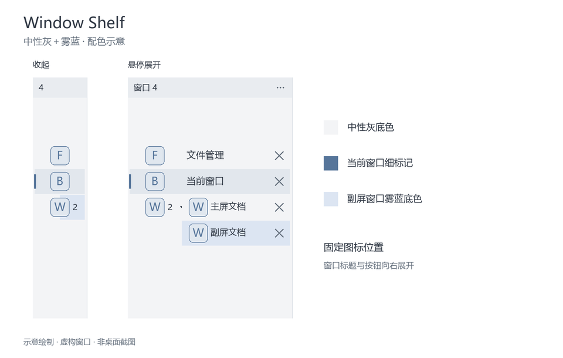

# Window Shelf 窗口侧栏

[English](README.md) | [简体中文](README.zh-CN.md)

覆盖原生任务栏应用区域的轻量窗口列表，保留系统托盘，支持分组、行内别名、拖动排序、直接关闭和跨屏显示。

**推荐配合 Windows 11 左侧竖向任务栏使用。** 本程序不负责把横向任务栏改成竖向，请先完成该设置，例如使用 Windhawk 的 [Vertical taskbar for Windows 11](https://windhawk.net/mods/taskbar-vertical)。发行包不包含 Windhawk 或其模组。



*根据配色方案重绘的示意图，使用虚构窗口标题，不是电脑桌面截图。实际应用图标保留各自原色。*

## v0.1.1 修复

登录后，Windows 有时会在其他应用仍处于前台时，把原生任务栏抬到 Shelf 上面。此时悬停仍能展开侧栏，但图标区域被原生任务栏遮挡。新版检查实际窗口层级，仅在需要时恢复到任务栏正上方，不激活自身、不改变尺寸；修复时保留原本位于任务栏上方的浮层优先顺序。

**从 v0.1.0 升级：**从菜单退出 Window Shelf，把新运行包解压到原安装目录，再启动。保留原数据目录和已有的 `window-shelf.data-dir` 文件；EXE 路径不变时，无需重新注册计划任务。本次修复没有新增参数或启动任务。

参见[中文更新记录](CHANGELOG.zh-CN.md)、[English changes](CHANGELOG.md)与[验证范围](docs/VALIDATION.zh-CN.md)。

## 下载与运行

1. 在 [Releases](https://github.com/Zhy54/window-shelf/releases) 下载 `WindowShelf-v0.1.1-win-x64.zip`。
2. 解压到长期保留的目录，运行 `WindowShelf.exe`。
3. 原生任务栏应为**左侧竖向**。横向、右侧任务栏或无法取得托盘边界时，覆盖层会隐藏。

目标环境为 Windows 11 x64、.NET Framework 4.8。运行 EXE 不需要 Python、浏览器、管理员权限或网络服务。当前预览版二进制未签名，界面菜单为中文；仓库说明提供中英文版本。

程序自身**不会自动注册开机启动**。若已配置计划任务，移动 EXE 后需要同步更新任务路径。

## 功能与操作

- 收起宽度与原生任务栏一致：每个应用一个居中图标，多窗口数量显示在右侧。
- 悬停展开标题和大关闭按钮；应用图标坐标、滚动位置保持不变。收起时为子窗口预留空间，避免鼠标目标跳动。
- 多窗口按应用分组，可展开/折叠。拖动组标题调整应用顺序，拖动子窗口调整组内顺序。
- 右键“重命名…”在原行编辑；Enter 保存、Esc 取消。清空名称或选择“恢复原标题”恢复实时标题。只修改侧栏别名，不改文档名称和应用标题。
- 点击前台窗口行最小化，点击后台或最小化窗口行切换/恢复。
- `×` 发送正常关闭请求，由应用处理保存提示或退到托盘，不结束进程。
- 副屏窗口使用雾蓝底色；同一应用的窗口跨主副屏分布时，分组显示双色底。
- 右键具体窗口选择“在另一块显示器显示”：移动现有窗口，不新开副本；最小化窗口先调整目标位置，再恢复显示。
- 列表能放下时居中，放不下时滚动，不靠缩小图标容纳窗口。

顶栏“⋯”可打开设置、重新加载设置、暂停和退出；`Ctrl+Alt+F12` 在快捷键可注册时切换覆盖层。系统托盘图标也可操作。退出后原生任务栏自然露出。

## 修改参数

首次运行在 `%LOCALAPPDATA%\WindowShelf` 创建配置：

| 文件 | 用途 |
|---|---|
| `settings.json` | 可编辑的布局、时序、字号、图标尺寸与配色 |
| `preferences.json` | 应用排序、折叠状态、仍然存续的窗口别名和组内顺序 |
| `status.json` | 本地数量、坐标等诊断信息，不是窗口标题历史记录 |

在“⋯”选择“打开设置文件”，保存 JSON 后选择“重新加载设置”。省略的字段使用默认值，超出范围的数值会被限制到有效范围。完整说明见 [参数表](docs/CONFIGURATION.zh-CN.md) 和 [示例配置](settings.example.json)。

启动参数 `--data-dir "C:\SomeFolder\WindowShelfData"` 可指定数据目录；也可在 EXE 旁放置 `window-shelf.data-dir` 文本文件，内容为绝对路径或相对 EXE 的目录。请勿上传自己的数据目录，其中可能包含窗口别名、程序路径等个人信息。

## 可选：登录桌面后延迟启动

在解压目录打开 PowerShell，执行：

```powershell
.\tools\Register-StartupTask.ps1 -ExecutablePath "$PWD\WindowShelf.exe" -DelaySeconds 30
```

创建名为 `WindowShelf` 的当前用户交互式计划任务，登录后延迟 30 秒，以普通权限运行；不是系统开机触发，也不写入“启动”文件夹。此项目不保存密码，注册操作不会立即启动任务。若本机策略要求管理员权限创建任务，仅注册步骤需要相应权限，任务运行仍为普通权限。

删除该启动任务：

```powershell
.\tools\Unregister-StartupTask.ps1
```

只删除该计划任务，不关闭正在运行的程序、不删除配置。保留任务指向的 EXE 路径。固定延迟不等于保证所有桌面组件已加载完成，程序还会等待可用的任务栏/托盘边界。

## 从源码构建

```powershell
.\build.ps1
```

使用目标 Windows 环境中的 .NET Framework x64 C# 编译器，输出 `bin\WindowShelf.exe`，不需要 NuGet 或另行下载 .NET SDK。源码和 DPI 清单位于 `src/`。

内部回归检查：

```powershell
$p = Start-Process .\bin\WindowShelf.exe -ArgumentList '--selftest','test-results\selftest.json' -Wait -PassThru
Get-Content .\test-results\selftest.json
```

添加 `--monitor-test` 可在两块已连接显示器之间移动程序自己创建的临时测试窗口。前台焦点检查独立为 `--native-test`，因为 Windows 可能拒绝程序化切换焦点。详情见 [验证与限制](docs/VALIDATION.zh-CN.md)。

## 使用边界

- 当前是围绕 Windows 11 左侧竖向任务栏开发的预览版，仅在主任务栏绘制一个覆盖层，不会在每块显示器各创建一份。
- 管理已打开窗口，不集成浏览器标签页，不显示未运行的固定应用。Win+数字快捷键仍按原生任务栏排序。
- 应用分组按应用标识/程序路径判断，特殊宿主程序可能需要适配。
- 窗口仍然存续时，重启侧栏可保留别名；关闭文档后重开，不保证认回旧别名。
- 普通权限不一定能控制管理员窗口；前台激活受 Windows 焦点规则限制。
- 跨屏功能是便利操作，**不构成屏幕共享隐私隔离**。应用可能自行重定位或弹出新对话框，共享前请用无敏感内容验证实际应用。
- 不同/混合 DPI、所有全屏应用、任务栏自动隐藏、系统弹出面板和特殊任务栏模组尚未完成全面验收。

## 许可证

[MIT](LICENSE)。与 Microsoft、Windhawk 无隶属关系。
